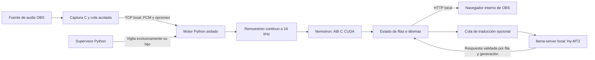

# Ingeniería y decisiones de diseño

## Contrato del producto

Una fuente OBS debe convertir una entrada de audio en subtítulos locales, detectar
el idioma sin configuración de entrada y permitir estilos por fragmento. La
traducción al español es un componente opcional. Mostrar y ocultar la fuente
controla el trabajo del motor. No se sustituyen los pesos originales de Nemotron.

Los objetivos de un segundo de demora, consumo medio del 20 % y sesiones de horas
requieren mediciones de extremo a extremo; no son garantías de esta versión.
La identificación de idioma y el reconocimiento del canto siguen siendo falibles.

## Separación de procesos

Dentro de OBS se ejecutan la captura, el transporte, las propiedades y el navegador.
El modelo no se carga dentro del proceso OBS. Un fallo del reconocedor se contiene
en el motor externo; el supervisor no reinicia OBS ni otros programas. C evita
bloquear el callback de audio con inferencia o peticiones HTTP. Python coordina
estado, remuestreo y traducción; la inferencia de producción utiliza código nativo
CUDA. Torch no es una dependencia del instalador de uso diario.

| Frontera | Implementación | Responsabilidad |
| --- | --- | --- |
| Fuente y visibilidad | `native/subtitle-source.c` | Conectar/desconectar el audio elegido, renderizar y exponer propiedades |
| Mezcla de programa | `native/program-audio.c` | Resolver la pista de emisión/grabación sin modificar las salidas; la fuente conecta su callback de mezcla |
| Captura y transporte | `native/plugin.c` | PCM mono, cola acotada, envío desde un worker |
| Inicio del motor | `native/engine-runtime.c`, `engine/launch.py` | Leer metadatos locales, instancia única y supervisión del hijo |
| Entrada del motor | `engine/server.py` | Validar paquetes, remuestrear, exponer estado y gestionar inactividad |
| ASR | `engine/nemo_native.py`, `engine/asr_native.py` | Contrato ABI C, cachés y parciales/finales |
| Identidad y caducidad | `engine/core.py` | Filas, generaciones, correo de traducción y contexto limitado |
| Idioma y estilos | `engine/spans.py`, `engine/language.py`, `engine/style.py` | Evidencia acústica/textual y validación de opciones |
| Traducción | `engine/translation.py` | Carga bajo demanda y publicación condicionada a la fila vigente |
| Presentación | `web/overlay.html`, `web/preview.html` | Cola visual, estilos por fragmento y vista previa |

Las rutas de la tabla son relativas a la raíz del repositorio. Cada cambio debe
mantener estas fronteras: las reglas visuales no deben modificar el vocabulario
del ASR y las referencias de evaluación no se entregan al reconocedor.

## Audio, orden y discontinuidades

El transporte utiliza una cabecera little-endian de 20 bytes, `<4sIIII>`:
identificador, frecuencia, cantidad, secuencia y flags. `BLC1` lleva entre 1 y
2048 muestras float32 mono; admite entrada entre 8 y 192 kHz. `BLCF` lleva un JSON
de opciones de hasta 8192 bytes. `BLCP` mantiene la conexión sin muestras.

El motor valida tamaños, frecuencia y finitud antes de aceptar el PCM. Aplica el
flag de silencio y limita el rango a [-1, 1]. Soxr conserva el estado entre
paquetes y remuestrea a 16 kHz. Cambiar la frecuencia o perder la secuencia reinicia
el epoch de audio y limpia el correo/contexto pendiente: no se unen muestras que
ya no tienen continuidad temporal.

El callback nativo no ejecuta inferencia. La cola nativa tiene capacidad fija y
la cola Python se configura en segundos de audio. Las pérdidas se contabilizan;
una cola llena no debe convertirse en historial ilimitado. La frecuencia, la
cantidad de audio recibido y la cola pendiente son métricas distintas.

## ASR y límites de segmentación

La producción usa Nemotron 3.5 ASR Streaming 0.6B Q8 con NeMo-Speech.cpp 0.2.0 y
contexto derecho 3. Sus pasos de 320 ms no equivalen a latencia hasta pantalla.
El prompt de entrada es automático; una regla de color no fuerza el idioma.

Silero ayuda al endpoint acústico. El masking está desactivado: el audio tenue o
incierto sigue llegando al ASR. El endpoint forzado de ocho segundos limita el
fragmento sin destruir las cachés acústicas/predictoras. El cierre real del flujo
ocurre al terminar, desconectar o alcanzar una pausa de ceros digitales exactos;
no se utiliza un umbral de volumen como filtro de palabras.

La etiqueta acústica puede llegar tarde. El análisis textual estima fronteras
antes, pero su puntuación no es una probabilidad calibrada de acierto. Una frase
corta puede conservar idioma incierto. No se corrigen palabras mediante listas
por canción o por idioma.

## Estado, traducción y memoria

Cada fila tiene `id` y `epoch`. Una solicitud de traducción conserva esa identidad
y el texto que originó la petición. Antes de publicar se verifica que la fila
existe, sigue vigente y pertenece a la misma generación. Una respuesta tardía se
descarta; no recupera el texto de una ventana anterior.

El `flow_group` permite continuar visualmente después de un límite técnico sin
fusionar la identidad de las traducciones. La presentación puede recortar líneas,
pero no reintroduce texto vencido. Los parciales repetidos no renuevan la duración
y un final repetido no recrea una fila retirada. La caducidad usa reloj monótono.

| Recurso | Límite o política |
| --- | --- |
| Audio Python pendiente | Configurable; perfil predeterminado 400 ms |
| Filas internas | Deque de 8; el límite visible también depende del estilo |
| Hipótesis y traducciones | Texto por fila acotado, sin historial completo |
| Eventos internos | Deque de 256 |
| Correo de traducción | Final prioritario y parcial más reciente |
| Contexto del traductor | 4 fragmentos, 1600 caracteres y TTL de 45 s por defecto |
| Detector de idiomas | Caché acotada de fragmentos |
| Modelo traductor | Se carga al activarlo y se libera al desactivarlo |
| Audio/transcripciones en disco | No se guardan |

No se promete memoria constante del controlador, OBS o del runtime externo
mediante estos límites: para demostrar estabilidad deben observarse los procesos
y la VRAM durante sesiones prolongadas. La utilización GPU global tampoco es
potencia eléctrica ni consumo exclusivo del plugin.

## Instalación y compatibilidad

El instalador opera dentro de la carpeta de este plugin. Las dependencias Python
y CUDA son locales; no ejecuta pip contra el Python global, no cambia el PATH y
no instala controladores, CUDA Toolkit, servicios ni tareas de inicio.

1. Comprueba arquitectura, OBS/motor en uso y controlador NVIDIA.
2. Consulta la API del controlador: se requiere CUDA 13.0 o superior y al menos
   un dispositivo accesible. La comprobación no carga los modelos.
3. Compara cada archivo del destino con el SHA256 esperado para el componente.
   Conserva los correctos. Busca copias idénticas en registros PEP 514 y rutas
   explícitas de Python/CUDA/PATH, sin ejecutar ni modificar esas dependencias.
4. Prepara copias privadas desde esas ubicaciones. Descarga únicamente los paquetes
   Python o bibliotecas nativas incompletos; cada archivo comprimido tiene su hash
   fijado dentro del EXE. Extrae en staging temporal y copia solo lo necesario al
   destino. Los modelos originales se descargan si faltan o fallan su checksum.
5. Verifica el manifiesto instalado. Valida la configuración en un archivo temporal,
   conserva opciones existentes y solo añade valores predeterminados ausentes.
6. Publica `runtime.json` mediante reemplazo atómico cuando sus valores cambian.
   Si configuración o metadatos ya coinciden, no se reescriben.

El inventario de archivos distingue instalación compacta y completa. El checksum
esperado forma parte de la clave de caché de comprobación: cambiar de componente
no reutiliza una decisión basada en otro contenido. El registro del desinstalador
puede actualizarse aunque no se sustituyan dependencias.

El EXE es un bootstrap: las dependencias grandes no forman parte de su carga
interna. El generador `tools/bootstrap_components.py` crea los grupos y sus
inventarios; `tools/installer_checks.py` genera las entradas explícitas de Inno.
`installer/reuse_dependencies.ps1` prepara archivos sin cambios globales y devuelve
qué grupos están incompletos. La página de descargas verifica el hash del ZIP y la
validación final comprueba cada archivo instalado. Una reparación parcial de un
paquete puede descargar su ZIP completo; no significa que sobrescriba sus archivos
ya correctos. Esto reduce la complejidad y las peticiones frente a miles de descargas
de archivos Python individuales.

La compatibilidad para reutilizar es deliberadamente exacta. No se deduce de que
un paquete diga «más nuevo». Las copias privadas también evitan que desinstalar o
actualizar el Python/Toolkit externos rompa el motor ya instalado. El controlador
NVIDIA permanece como dependencia del sistema y se comprueba mediante su API.

La identidad del editor se trata aparte de la integridad de las descargas. Esta
versión no tiene una firma Authenticode confiable: SHA256 no reemplaza esa firma.
Se ofrece un punto de integración para firmar instalador/desinstalador en builds
del editor; no se instala un certificado autofirmado ni se desactiva SmartScreen.

**Controlador, Toolkit y bibliotecas son conceptos diferentes.** Instalar CUDA
Toolkit 13 no demuestra que el controlador lo soporte. Un controlador posterior
puede ejecutar aplicaciones anteriores mediante compatibilidad hacia atrás; una
DLL de una versión mayor distinta no sustituye automáticamente una biblioteca
que el binario importa por nombre/ABI. Por eso el controlador se reutiliza sin
modificaciones y las bibliotecas privadas del paquete se verifican exactamente.

La [documentación oficial de compatibilidad NVIDIA](https://docs.nvidia.com/deploy/cuda-compatibility/index.html)
y las [notas CUDA 13](https://docs.nvidia.com/cuda/archive/13.0.0/cuda-toolkit-release-notes/index.html)
explican los límites de compatibilidad entre versiones menores y funciones nuevas.
La condición CUDA >=13 es necesaria; no certifica por sí sola cualquier GPU o
combinación de kernels. Un fallo de carga debe mostrarse como error del motor.
No se intenta corregirlo instalando componentes globales automáticamente.

## Fallos y recuperación

| Situación | Respuesta |
| --- | --- |
| OBS o el motor de este plugin está en uso | Bloquear actualización y pedir cerrar/esperar; no matar procesos |
| Controlador ausente, antiguo o sin GPU accesible | Detener la instalación antes de copiar archivos del plugin |
| Descarga o checksum incorrecto | No aceptar ese recurso; mostrar error y permitir reintentar |
| Archivo instalado correcto | Reutilizarlo sin copiarlo de nuevo |
| Archivo del paquete dañado/diferente | Sustituirlo exclusivamente dentro de la carpeta del plugin |
| Configuración existente inválida | Fallar sin reemplazarla silenciosamente por valores predeterminados |
| Proceso ASR sin progreso | Supervisor reinicia únicamente su hijo |
| Silencio o hipótesis vacía con progreso | No confundirlo con bloqueo |
| Traducción que llega tras la caducidad | Descartar por identidad/generación |

La instalación no se declara una transacción con rollback integral: un fallo de
disco durante la copia puede requerir reinstalar este plugin. La verificación y
la activación final de metadatos reducen el riesgo de usar archivos parciales;
no constituyen permiso para modificar o reparar el sistema operativo.

## Construcción, publicación y verificación

Versiones, revisiones y hashes se fijan en `installer/resources.json`,
`requirements-bundle.lock` y `tools/bootstrap_build.ps1`. Las herramientas de
compilación se descargan desde sus fuentes y se verifican antes de ejecutarlas.
El instalador no contiene el entorno virtual del desarrollador.

La publicación utiliza un repositorio con historial inicial limpio. Se revisan
los archivos efectivamente seguidos por Git; el auditor también rechaza salidas
locales que alguien haya añadido a la fuerza. El ZIP de código solo toma archivos
seguidos y vuelve a comprobar las exclusiones. Rutas de compilación nativas se
remapean; los terceros mantienen sus avisos de origen y licencias.

Los tests cubren límites, caducidad, identidad de traducción, opciones visuales,
integridad del instalador y conservación de configuración. GitHub Actions verifica
tests, análisis estático, auditoría y compilación nativa. La integración GPU exige
un host real: instalación, arranque desde la fuente, audio a velocidad normal,
renderizador e inactividad. Esos ensayos no reemplazan una referencia para medir
precisión, un reloj acústico para medir demora o una sesión larga para medir fugas.
